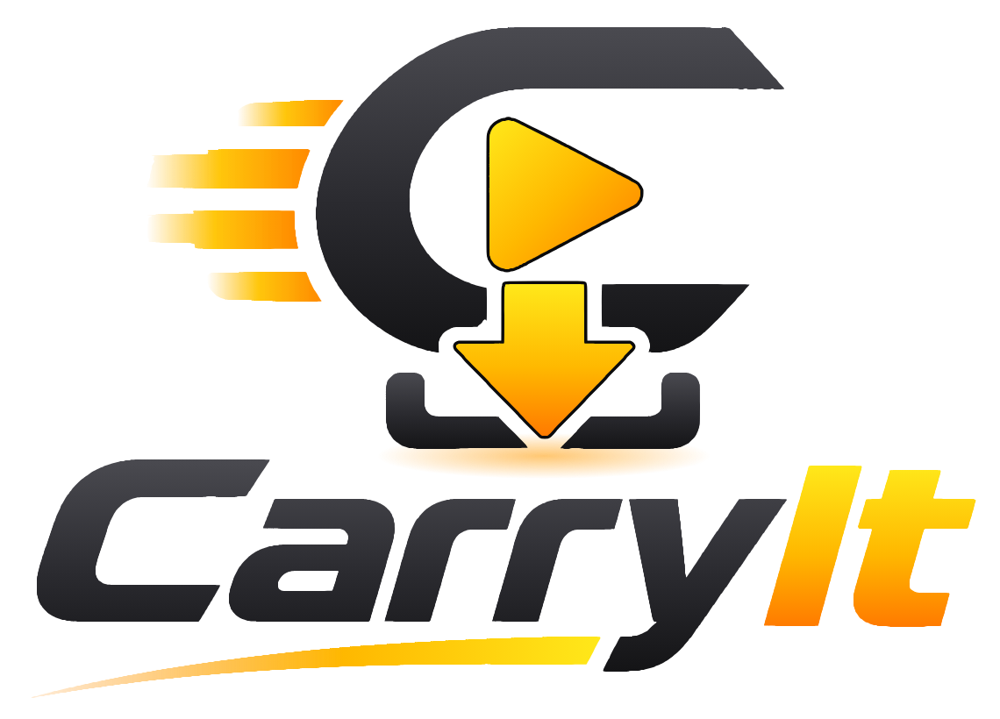

<p align="center">
  <picture>
    <source media="(prefers-color-scheme: dark)" srcset="branding/png/carryit-logo.png">
    
  </picture>
</p>

Aplicación de escritorio gratuita para Windows: descarga videos de YouTube, o solo el audio, al estilo de aTube Catcher o 4K Video Downloader.
Usa [yt-dlp](https://github.com/yt-dlp/yt-dlp) como motor, FFmpeg para unir y convertir, y CustomTkinter para la interfaz.

## Descargar e instalar

1. Entra a **[Descargas (Releases)](https://github.com/CarryErickMX/CarryIt/releases/latest)** y baja `CarryIt-Setup-X.Y.Z.exe`.
2. Ábrelo y sigue los pasos. No pide permisos de administrador y no hace falta instalar nada más: Python, FFmpeg y Deno ya vienen incluidos.
3. Abre **CarryIt** desde el menú Inicio o el Escritorio.

¿Prefieres no instalar? Baja `CarryIt-X.Y.Z-portable.zip`, descomprímelo y abre `CarryIt.exe`.

> **Si Windows muestra «Windows protegió su PC»**: pasa con los programas nuevos sin firma digital. Haz clic en **Más información → Ejecutar de todas formas**. Si tu PC tiene activado *Smart App Control*, Windows no permitirá abrirlo hasta que el programa esté firmado (ver «Firma digital» más abajo).

Para comprobar que la descarga no se dañó, compara su huella con `SHA256SUMS.txt`:

```powershell
Get-FileHash .\CarryIt-Setup-1.1.0.exe
```

## Funciones

- **Video** en MP4 (H.264, se reproduce en cualquier dispositivo), MKV o WEBM, de 144p hasta 4K.
- **Solo audio** en MP3, M4A u OPUS (de 128 a 320 kbps), o FLAC/WAV sin pérdida, con portada y datos incrustados.
- **Buscar escribiendo**: si escribes un nombre en lugar de un enlace, muestra resultados de YouTube con miniatura para elegir.
- **Detecta enlaces copiados**: copias un enlace de YouTube en el navegador y, al volver a CarryIt, ya está pegado y analizado.
- **Análisis del enlace**: miniatura, título, canal, duración y las calidades que realmente tiene el video.
- **Historial** que se conserva al cerrar, con buscador, y aviso si intentas bajar algo que ya tienes.
- **Aviso al terminar**: si la ventana está en segundo plano, su botón parpadea en la barra de tareas y suena un aviso.
- **Ajustes**: tema, descargas al mismo tiempo, nombre de los archivos (título, título - canal o canal - título) y carpetas separadas para videos y audios.
- **Copiar informe**: si una descarga falla, un botón junta los datos del problema (sin tu nombre de usuario) para enviarlos a quien te ayude.
- **Otros sitios**: además de YouTube, Facebook, TikTok, X (Twitter), Dailymotion, SoundCloud, Twitch y muchos más. Si el enlace solo tiene audio, la app cambia sola a «Solo audio».
- **Sitios con cuenta** (Instagram, Vimeo, Reddit…): en Ajustes puedes usar la sesión que ya tienes abierta en tu navegador.
- **Subtítulos** en español, inglés o ambos, incrustados en el video (y, si quieres, también como archivo .srt). Si el sitio no los tiene, el video se descarga igual y te avisa.
- **Solo una parte**: descarga únicamente un fragmento, por ejemplo del minuto 1:20 al 4:05.
- **Pausar y reanudar** descargas sin perder lo ya bajado, y **velocidad máxima** configurable para no saturar tu internet.
- **Título y artista**: antes de bajar un audio puedes corregir cómo se llamará la canción y quién la canta (también renombra el archivo).
- **Español e inglés**: la app se abre en el idioma de Windows; en Ajustes puedes elegir otro.
- **Listas de reproducción**: el botón **Elegir videos** permite marcar cuáles bajar, con buscador y botones Todos/Ninguno. Se guardan en una carpeta con el nombre de la lista.
- **Cola de descargas** con progreso, velocidad, tiempo restante, cancelar, reintentar y «Mostrar» el archivo. Hasta 3 descargas al mismo tiempo.
- **Reintento automático** cuando YouTube rechaza una descarga (error 403).
- **Se mantiene al día sola**: yt-dlp se actualiza automáticamente (YouTube cambia seguido) y la app avisa cuando hay una versión nueva de sí misma en GitHub.
- Tema claro u oscuro, y recuerda tus preferencias.

## Aviso legal

Descarga solo contenido del que tengas los derechos o cuyo autor permita descargarlo. Descargar videos de YouTube puede ir contra sus condiciones de servicio; cada usuario es responsable del uso que le dé. El programa se ofrece «tal cual», sin garantía.

---

## Para desarrolladores

### Ejecutar desde el código

```bat
instalar.bat
```

Crea el entorno `.venv`, instala las dependencias (y Python 3.12 y FFmpeg con winget si faltan) y crea accesos directos que abren la app con `pythonw.exe`.

Diagnóstico sin interfaz (descarga de prueba y apertura de la ventana; escribe `selftest.json`):

```bat
.venv\Scripts\python.exe main.py --selftest https://www.youtube.com/watch?v=jNQXAC9IVRw C:\carpeta\de\prueba
```

### Estructura

| Archivo | Qué hace |
|---|---|
| `main.py` | Punto de entrada: registro de errores, carga del yt-dlp actualizado y `--selftest`. |
| `carryit/__init__.py` | Nombre, versión (`__version__`) y repositorio de GitHub (`GITHUB_REPO`). |
| `carryit/core.py` | Lógica de yt-dlp: análisis, opciones, progreso, reintentos, cancelación y búsqueda de FFmpeg y Deno. |
| `carryit/gui.py` | Interfaz con CustomTkinter. |
| `carryit/updater.py` | Actualización de yt-dlp desde PyPI y aviso de versiones nuevas de la app. |
| `carryit/settings.py` | Preferencias en `%APPDATA%\CarryIt\settings.json`. |
| `build.py` | Genera el .exe, el instalador, el ZIP portátil y `SHA256SUMS.txt`. |
| `installer/` | Script de Inno Setup y avisos que muestra el instalador. |
| `.github/workflows/release.yml` | Compila y publica en GitHub Releases al subir una etiqueta `vX.Y.Z`. |
| `accesos.py` | Accesos directos para la versión de desarrollo. |
| `branding/` | Identidad visual: diseños originales, SVG, PNG e ICO. |
| `tools/branding.py` | Regenera toda la identidad visual a partir de los diseños originales. |
| `carryit/i18n.py` | Idiomas: los textos se escriben en español con `_("…")` y aquí está su traducción al inglés. |
| `tools/i18n_check.py` | Verifica que todos los textos marcados tengan traducción (úsalo después de agregar textos). |

### Identidad visual

| Pieza | Archivo | Uso |
|---|---|---|
| Logo principal | `branding/svg/carryit-logo.svg` (fondos oscuros), `carryit-logo-claro.svg` (fondos claros), `carryit-logo-fondo-negro.svg` | Instalador, pantalla de carga, página web |
| Ícono de la app | `branding/svg/carryit-icono.svg`, `branding/ico/carryit.ico` (16–256 px) | Windows, barra de tareas, accesos directos |
| Símbolo | `branding/svg/carryit-simbolo.svg`, `carryit-simbolo-claro.svg` | Encabezado de la app |
| PNG | `branding/png/` en 256, 512 y 1024 px | Redes, página web, documentación |

Para regenerarla después de cambiar los diseños en `branding/fuente/`:

```bat
.venv\Scripts\python.exe -m pip install -r requirements-dev.txt
.venv\Scripts\python.exe tools\branding.py
```

### Compilar a mano

Requiere `pip install pyinstaller` e Inno Setup 6 (`winget install JRSoftware.InnoSetup`):

```bat
.venv\Scripts\python.exe build.py --ffmpeg C:\ruta\a\ffmpeg\bin
```

## Publicar una versión en GitHub

**Una sola vez:**

1. Crea el repositorio en GitHub (por ejemplo `CarryIt`) y sube este código.
2. En `carryit/__init__.py`, `GITHUB_REPO` indica el repositorio (`"CarryErickMX/CarryIt"`); la app lo usa para avisar de versiones nuevas.

**Cada versión:**

1. Sube el número en `carryit/__init__.py` (por ejemplo `__version__ = "1.2.0"`).
2. Crea y sube la etiqueta:

   ```bash
   git tag v1.2.0
   git push origin v1.2.0
   ```

3. GitHub Actions compila en una máquina Windows limpia, descarga FFmpeg (verificando su SHA-256), prueba el .exe y publica la Release con el instalador, el ZIP y las huellas.

Si la etiqueta no coincide con `__version__`, la compilación se detiene para evitar publicar con el número equivocado.

### Firma digital

Sin firma, Windows muestra advertencias (SmartScreen) y, con *Smart App Control*, bloquea el programa. Opciones para firmar:

- **SignPath Foundation**: firma gratuita para proyectos de código abierto alojados en GitHub (requiere solicitarla y cumplir sus condiciones).
- **Certificado «Open Source» de Certum**: de bajo costo, para desarrolladores de código abierto.
- **Azure Trusted Signing** o un certificado OV/EV de una autoridad comercial: de pago y con validación de identidad.

Cuando tengas el certificado, define el secreto `SIGN_COMMAND` en el repositorio (ver `build.py`) y activa la línea `env` en el workflow.

## Licencia

Código propio con licencia MIT (`LICENSE`). La distribución binaria incluye componentes GPL (FFmpeg, mutagen) y se ofrece bajo los términos de la GPL v3; ver `THIRD_PARTY_NOTICES.md`.
